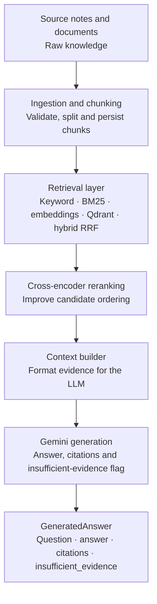

instead of uuid4 we used deterministic id chunk id

chunking 
    - fixed size chunking
    - paragraph based chunking

 - sentence vector embedding 384

 - abentention & grounded answer the model has given has the citation

 - Tool Contract : While a basic JSON Schema only tells a model what fields or parameters a tool accepts, a full tool contract defines when the tool is safe to use, what side effects it has, and how failures or rollbacks must be handled

 # Personal Knowledge Engine — Learning Record

> **Current milestone:** End of Week 6  
> **Technologies:** Python · Retrieval-Augmented Generation (RAG) · Semantic Search · Gemini API

## Learning Record at a Glance

| Measure | Count |
| --- | ---: |
| Core learning phases covered | 6 weeks |
| Retrieval evaluation questions | 50 |
| Retrieval approaches compared | 6 |
| Grounding scenarios tested | 3 |

## Week 1 — Python project foundations and document ingestion

Main topic: How do we bring raw knowledge into a Python application in a structured, reliable way?

### Concepts covered

| Topic               | What you learned                                                                  |
| ------------------- | --------------------------------------------------------------------------------- |
| Project structure   | Organizing Python code into modules rather than keeping everything in one script. |
| Python environments | Using Python 3.12 and `uv` to manage your project environment and dependencies.   |
| Configuration       | Keeping settings such as data directories and chunk parameters in one place.      |
| Data models         | Representing documents and chunks with defined fields and types.                  |
| Data validation     | Using Pydantic to validate input and catch invalid values early.                  |
| Document ingestion  | Loading source material so the application can process it.                        |

### Important concepts to understand

1\. Why separate modules?

Your project separates responsibilities into files such as `ingestion.py`, `models.py`, and `config.py`.

This makes the code easier to maintain. If you later improve document ingestion, you shouldn't need to rewrite your retrieval logic.

2\. Why data models?

Your `Document` model represents a source document. It contains fields such as:

- `document_id`: identifies the document.
- `content`: the text itself.
- `source`: where the text came from.
- `metadata`: additional information about the source.
- `created_at`: a timestamp.

Pydantic checks that data conforms to the model's requirements.

3\. Why configuration?

Your `config.py` centralizes settings, including your data directory and chunk size. This is better than scattering fixed paths and parameters throughout the code.

### Implementation completed

- Python project scaffold and dependencies managed with `uv`.
- Configuration through `config.py`.
- Data models in `models.py`.
- Document ingestion logic in `ingestion.py`.
- Initial source notes stored under `data/`.

Key takeaway: Raw information needs a predictable structure before a search system can work reliably with it.

## Week 2 — Text chunking and persistence

Main topic: How do we turn large documents into manageable pieces of knowledge?

### Concepts covered

| Topic          | What it means                                                               |
| -------------- | --------------------------------------------------------------------------- |
| Chunking       | Dividing a document into smaller text sections.                             |
| Chunk size     | How much text is placed in each section.                                    |
| Chunk overlap  | Repeating some text between adjacent sections.                              |
| Chunk metadata | Tracking which document a chunk belongs to and where it appeared.           |
| Persistence    | Saving processed data so it can be reused without repeating all processing. |
| JSON Lines     | Storing one JSON record per line.                                           |

### Why chunking matters

Imagine a 10-page document. Sending the entire document to a retrieval system for every question would be inefficient and could bury the most relevant passage among unrelated content.

Instead, we split it into smaller chunks.

Your current configuration uses:

- Chunk size: 500 characters.
- Overlap: 50 characters.

The overlap helps preserve context around chunk boundaries. For example, a statement may begin near the end of one chunk and continue into the next.

Too-small chunks may lose context; too-large chunks may include too much irrelevant material.

### Implementation completed

In `chunking.py`, you implemented the chunking component. The `DocumentChunk` model tracks fields including:

- `chunk_id`
- `document_id`
- `chunk_index`
- `start_char`
- `end_char`
- `content`

Processed chunks are saved in:

`data/processed/chunks.jsonl`

Key takeaway: Documents are source material; chunks are the units your retrieval system searches and returns.

## Week 3 — Keyword retrieval, BM25 and evaluation metrics

Main topic: How does a search engine find the most relevant chunks for a question?

This was your first major retrieval milestone.

### Concepts covered

1\. Keyword retrieval

Keyword search looks for terms that overlap between a query and document chunks. It's easy to understand and can work well when the user uses the same terms as the source.

Its weakness is that two passages can express the same meaning with different wording.

2\. BM25

BM25 is a ranking algorithm commonly used in text search. It considers factors such as:

- How often query terms occur in a document.
- How informative those terms are across the collection.
- The document's length relative to other documents.

It is more sophisticated than simply counting matching words.

3\. Top-k retrieval

The retrieval system returns the best `k` candidates. For example, `top_k=5` asks for the five highest-ranked results.

4\. Evaluation datasets

Your questions are stored in:

`data/evaluation/questions.jsonl`

The benchmark now has 50 questions with expected relevant chunk IDs. That lets you compare retrieval methods against known labels instead of judging results only by eye.

### Evaluation metrics

| Metric       | What it tells you                                                            |
| ------------ | ---------------------------------------------------------------------------- |
| Precision\@5 | What fraction of the five retrieved chunks are relevant, on average?         |
| Recall\@5    | What fraction of the labeled relevant chunks were found within the top five? |
| MRR          | How high does the first relevant result appear in the rankings?              |

For example, if the first relevant chunk is ranked first, that question receives a reciprocal rank of \\(1/1=1\\). If the first relevant chunk is ranked fourth, it receives \\(1/4=0.25\\).

MRR averages these values across the questions.

### Implementation completed

- `retrieval.py` — keyword retrieval.
- `bm25.py` — BM25 ranking.
- `evaluation.py` — evaluation metrics.
- `scripts/evaluate_retrieval.py` — benchmark evaluation.
- `scripts/compare_retrievers.py` — retriever comparison.

Key takeaway: A search system is not automatically good because it returns results. We need measurable evidence that its results are relevant.

## Week 4 — Embeddings, semantic search, Qdrant and hybrid retrieval

Main topic: How do we retrieve information by meaning, rather than only by matching words?

This week introduced the main building blocks of a modern RAG retrieval system.

### 1. Text embeddings

An embedding model converts text into a numeric vector.

For example, it maps a chunk of text into a list of numbers that represents learned semantic features. Text with related meaning can have vectors that are closer together, although this is not guaranteed for every pair of sentences.

Your project uses:

`sentence-transformers/all-MiniLM-L6-v2`

The embeddings have 384 dimensions.

### 2. Cosine similarity

Cosine similarity compares the direction of two vectors. In semantic search, it helps rank chunks by how similar their embeddings are to the query embedding.

Your embedding implementation normalizes its vectors, which supports consistent similarity calculations.

### 3. Vector databases

A vector database stores embeddings and makes them searchable.

Your project uses Qdrant in local persistent mode.

Your implementation creates a collection with 384-dimensional vectors and cosine distance, and stores chunk identifiers and text in the payload. Deterministic IDs help avoid creating a completely new point identity each time the same chunk is indexed.

### 4. Hybrid retrieval

Keyword and semantic retrieval have different strengths:

- Keyword retrieval is useful when exact names, identifiers or technical terms matter.
- Semantic retrieval is useful when a question and a source passage express similar ideas using different wording.

Your `hybrid.py` combines BM25 and Qdrant semantic results using Reciprocal Rank Fusion (RRF).

RRF combines rankings rather than directly comparing the underlying raw scores. This matters because BM25 scores and vector similarity scores are on different scales.

### Implementation completed

- `embeddings.py`
- `similarity.py`
- `semantic.py`
- `vector_store.py`
- `qdrant_retrieval.py`
- `hybrid.py`

You also tested that Qdrant's semantic results matched those from the in-memory semantic retriever in your current test setup.

Key takeaway: Hybrid retrieval combines lexical matching and semantic similarity to improve the chance that relevant knowledge is retrieved.

## Week 5 — Reranking and the retrieval pipeline

Main topic: How do we refine an initial list of relevant candidates to improve the final ranking?

Your project now uses two retrieval stages.

Stage 1: Candidate retrieval

BM25 + semantic retrieval + RRF

Collect a relatively broad set of candidates

Stage 2: Cross-encoder reranking

Evaluate each query–chunk pair

Reorder candidates by estimated relevance

Final top-k chunks

Pass the best-ranked results onward

### Bi-encoders versus cross-encoders

Your embedding model works as a bi-encoder: it represents the query and the chunk independently so vector retrieval can be efficient.

Your reranker uses:

`cross-encoder/ms-marco-MiniLM-L-6-v2`

A cross-encoder evaluates the query and candidate text together. This can improve relevance ordering, though it costs more computation per candidate.

The combination gives you efficient candidate retrieval followed by a more detailed relevance assessment.

### Implementation completed

- `reranking.py` — cross-encoder reranking.
- `pipeline.py` — coordinates hybrid retrieval and reranking.

Your pipeline uses a candidate pool (`candidate_k`) and then returns the requested `top_k` results.

Key takeaway: Retrieval tries to find the right information; reranking tries to put the best information first.

## Week 6 — RAG context, Gemini generation, citations and grounding

Main topic: How do we turn retrieved evidence into a useful, evidence-based answer?

This is the latest milestone you've completed.

### 1. Context building

Your `context_builder.py` formats retrieved chunks into a context block that includes the chunk ID, rank and score.

This provides the generator with the relevant text it should use to answer the user's question.

### 2. Prompt design

Your Gemini generator supplies instructions that tell the model to use only the provided context, avoid inventing facts and report insufficient evidence when necessary.

A prompt helps guide behavior, but it is not a guarantee that every generated claim will be correct.

### 3. Hosted LLM integration

You installed Google's `google-genai` SDK and tested a real API call.

Your generator uses Gemini to produce an answer with structured fields instead of relying on a free-form response alone.

### 4. Structured output

Your `GeminiDraft` schema defines the expected response:

- `answer`
- `cited_chunk_ids`
- `insufficient_evidence`

This gives your application predictable fields to validate and process.

### 5. Citation validation

Your generator checks whether the chunk IDs returned by Gemini actually exist among the retrieved chunks.

This prevents the model from citing an arbitrary, nonexistent chunk ID.

However, a valid citation ID is not proof that the cited text supports every statement in the answer. Evaluating that connection between claims and evidence is part of the quality work still ahead.

### 6. Abstention

Abstention means declining to give a substantive answer when there is insufficient evidence.

You implemented two paths:

- No retrieved chunks: return an insufficient-information response directly.
- Retrieved chunks that do not answer the question: ask Gemini to judge whether the evidence is enough.

### 7. Orchestration

Your `KnowledgeAnswerer` connects the retrieval pipeline and answer generator. This keeps the retrieval system separate from the LLM provider, which also allows the mock generator to remain available for testing.

### Implementation completed

- `context_builder.py`
- `generation.py` — mock generation.
- `gemini_generation.py` — Gemini-based generation.
- `answering.py` — coordinates retrieval and generation.
- `scripts/test_gemini.py`
- `scripts/test_gemini_generation.py`
- `scripts/test_gemini_grounding.py`

Your grounding tests passed for a supported question, an unsupported question and a question with no retrieved evidence.

Key takeaway: A RAG engine does more than generate text. It retrieves evidence, supplies context, generates a response, and tracks the source material used.

# Current Architecture: What You Have Built

This is the complete flow of your current system.

## Current Retrieval Benchmark

You also have baseline measurements comparing all six retrieval configurations.

| Retrieval method  | Precision\@5 | Recall\@5 | MRR   |
| ----------------- | ------------ | --------- | ----- |
| Keyword           | 0.232        | 0.933     | 0.797 |
| BM25              | 0.240        | 0.960     | 0.830 |
| Semantic          | 0.232        | 0.953     | 0.783 |
| Qdrant semantic   | 0.232        | 0.953     | 0.783 |
| Hybrid            | 0.244        | 0.983     | 0.790 |
| Hybrid + reranker | 0.252        | 1.000     | 0.872 |

Your current best result is hybrid retrieval plus reranking. On this 50-question benchmark, it has the highest score for all three metrics.

Recall\@5 of 1.000 means all labeled relevant chunks were found within the top five under the current evaluation labels. It does not prove that every potentially useful passage in your entire knowledge base was found. We need to assess the completeness and quality of the labels, as well as answer quality.